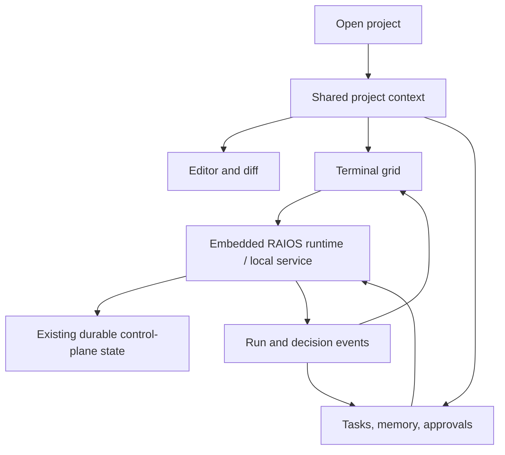

# RAIOS Workspace — Product Design v0.1

Date: 2026-10-04 · Status: design draft for owner review

## Product definition

Visual update (2026-10-05): the native application now uses the owner's [GT-LCARS KDE visual direction](gt-lcars-theme.md), including exact orange/blue/cream tokens, bundled Antonio type, panel turns, and segmented rails. Dark/light native-client screenshots supersede the earlier neutral prototype's styling.

Implementation update (2026-10-05): the first native Linux development build is available in [tools/raios-workspace](../../../tools/raios-workspace/README.md). Its reviewed stack is Tauri 2, CodeMirror, xterm, portable-pty, cap-std, and embedded raios-core. Real file editing, PTYs, project-scoped snapshots, and queue/start/consumption receipts are implemented. Existing approval decisions remain read-only here; the broader requirements below remain the product roadmap. The static preview still uses demonstration data.

Build a desktop development workspace that contains R-AI-OS as its foundational orchestration system. The editor, terminal grid, agents, tasks, memory, approvals, and audit history share one project context. Opening a project should be sufficient to establish that context throughout the application.

Herdr informs terminal layout and session handling. Zed informs editing, file navigation, search, and change review. These are design references; this draft does not approve a dependency, fork, license strategy, or implementation framework. RAIOS owns task/run/memory/policy truth. The desktop application owns presentation, editor documents, terminal views, focus, and layout.

The working product name is **RAIOS Workspace**. Product value: keep code and autonomous work visible together, with a clear explanation whenever an agent waits.

## First user's job

A developer opens a local repository, gives an agent a concrete task, edits or reviews code while it runs, resolves a scoped approval, and hands the work to another agent without losing project context. The workspace must explain whether the receiving agent actually started and whether context delivery is confirmed.

The primary user is a developer working with multiple local agent CLIs. Linux is the first delivery target; macOS and Windows retain the same product model while showing their actual runtime capabilities. No fabricated universal eBPF support, zero-cost tracing, or guaranteed sub-millisecond termination belongs in the product promise.

## Application structure

| Region | Responsibility | Initial design |
|---|---|---|
| Window toolbar | Project scope, command search, theme, connection state | Persistent, native window controls in production |
| Project sidebar | File tree and changed-file navigation | 218 px; resizable/hideable in production |
| Editor | Open documents and unified change review | Main focus, with file tabs and breadcrumbs |
| Agent dock | Real terminal sessions and explicit process states | Two adjacent panes beneath the editor |
| Context inspector | Current task, approvals, handoff receipt; memory and activity tabs | 292 px; collapsible in production |
| Status bar | Project/branch and current presentation mode | Quiet, persistent |

The draft defaults to a balanced layout. Editor focus expands code and collapses the terminal dock. Agent focus expands the terminal grid and keeps a compact code preview. Layout changes preserve the selected file, task, and sessions; they never start or stop processes.



“Embedded” is a product integration requirement, not a demand to put every subsystem in the GUI thread. Whether the native shell owns an in-process runtime or a supervised local service remains an architectural decision. Do not create a second desktop task database or grant the web preview a direct SQLite connection.

## Main flows

### 1. Open a project

Choose a local folder → validate access and project identity → load the file tree → hydrate project memory/tasks/run history → display connection/capability status. Empty repositories show “Open a file or create your first task” with clear actions. A missing memory file is an empty state, not a fatal error. Project switching must preserve each project's draft prompts and layout, and must never attach another project's handoff.

### 2. Start an agent

Choose Claude/Codex/OpenCode/Antigravity → inspect the selected project and task → enter the initial instruction → launch → display the terminal and start receipt. Authentication or missing executable errors appear next to the failed launch with “Retry” and “Check agent setup”. A panel opening is not proof that a process started. Closing a terminal view and stopping its process are separate actions.

### 3. Resolve an approval

The inspector explains **who requests what, in which project, and why it waits**. “Review change” opens the exact diff. Approval/rejection applies only to the shown request and revision. A policy command approval must also show the executable/arguments, working directory, relevant paths/network destination, and policy reason. Request type is explicit: change review, handoff review, and command permission are different contracts.

If the revision or request changes while it is being reviewed, invalidate the decision controls and reload the request. Expired, already-resolved, and rejected approvals retain their reason in activity history. The prototype demonstrates a file-change approval, not a universal interception system.

### 4. Hand off a task

Choose the recipient → inspect project/task/source → write a context summary → choose “Start recipient now” or queue only → show a durable receipt alongside the originating task. A summary includes relevant files, evidence, and next action; secrets are excluded. Existing CLI queue/start behavior is the baseline; the detailed desktop receipt below is a **proposed extension**.

| Receipt stage | Evidence needed | User-facing label |
|---|---|---|
| Queued | Handoff record committed for this project and recipient | Queued; recipient has not started |
| Starting | Launch request accepted, no process confirmation yet | Starting recipient |
| Started | Actual process/session identity confirmed | Recipient started |
| Delivered | Harness-specific delivery acknowledgement or defined delivery evidence | Context delivered |
| Working | Agent progress evidence attributable to the receiving run | Working on task |
| Completed | Task result and required review evidence | Completed |
| Failed / blocked | Stage-specific error with retry eligibility | Could not start / waiting for approval / delivery unconfirmed |

The current handoff consumption record does **not** establish that a model read the context. Do not relabel a spawn event as model acknowledgement. For a harness without acknowledgements, show “Context supplied at launch; reading unconfirmed”. Silence is not failure and is not success: show last confirmed event, elapsed time, and available recovery actions. Never mark a task completed because a handoff was queued or a process exited successfully.

Retry uses the same task/project intent and a new attempt identity. It must not duplicate running agents or consume another project's queue. The user can review the receipt, retry a failed launch, or queue without starting. Cancellation affects only the selected run; an already-delivered handoff stays in history.

### 5. Lose and restore the runtime connection

Keep code editing and cached history available. Show a persistent offline banner with last synchronization time. Disable new run, handoff, approval, and stop submissions; explain why at the point of action. Do not silently queue execution requests while disconnected. On reconnect, fetch a fresh snapshot and reconcile ordered events before enabling decisions. A terminal with no confirmed surviving process displays “Session ended”; process persistence across a reboot is not promised.

## Screen states

| State | Required presentation | Recovery |
|---|---|---|
| No project | Folder picker and recent projects | Open project |
| Project loading | Progressive file/task hydration; no fake progress percentages | Cancel opening |
| No agents | Empty dock with project-scoped “Start agent” | Launch composer |
| Agent running | Identity, task, project, terminal output, last confirmed event | Handoff / stop selected run |
| Needs human decision | Persistent inspector entry with scope and reason | Review, approve once, or reject |
| Agent launch failed | Error replaces “starting”; pending handoff preserved | Setup check / retry |
| Runtime disconnected | Last-known state visibly stale; mutation controls unavailable | Reconnect |
| Unsaved document | Tab marker; explicit save/close handling | Save / discard / cancel |
| Concurrent file change | Revision mismatch; show both edits | Resolve before applying |
| Unsupported capability | Plain explanation in runtime settings | Use available fallback |

## Interaction and visual language

- Use a restrained neutral desktop palette, one warm amber selection/action accent, and syntax colors for code. Status always has a text label; color alone never communicates meaning.
- System UI font with a system monospace stack for code and terminals. Default interface size 13–14 px, body text 14 px, terminal/code 13 px. Keep primary controls at least 28 px tall; provide a visible keyboard focus ring.
- Dense panes, clear separators, and few nested containers. No decorative metrics, token estimates, “live” pulses, or gradients. Every counter must represent records, not invented telemetry.
- Provide dark/light appearance, keyboard access to every action, reduced-motion behavior, and semantic labels. Production adopts platform-standard title bars, menus, shortcuts, folder dialogs, and IME behavior.
- Core shortcuts: Ctrl/Cmd+K command palette; Escape dismisses dialogs; Ctrl/Cmd+1/2/3 switches layout. Prototype shortcuts are examples and must be checked against native editor conflicts before implementation.
- Design target: 1440×900. At smaller widths the inspector moves below the main workspace; the file sidebar may collapse. At 200% scaling controls remain reachable without a fixed-height window trap. Production uses adjustable splitters, remembers layout per project, and never makes a modal the sole place to see a waiting request.

Guideline basis: the locally installed `apple-design` skill's accessibility, color, layout, typography, focus, and generative-AI references. Apply the principles cross-platform without copying macOS chrome onto Linux or Windows.

## Existing RAIOS surfaces and implementation gaps

These are source-verified definitions, not proof that every execution path already meets desktop requirements.

| Product need | Existing source anchor | Still needed for desktop |
|---|---|---|
| Project/task/run/approval presentation | `crates/raios-contracts/src/dto.rs`: ProjectDto, UnifiedTaskDto, ActiveRunDto, ScoredApprovalDto | Project-scoped selection model and freshness/revision markers |
| Agent start/stop intent | `crates/raios-contracts/src/command.rs`: LaunchAgent, CancelAgentRun | Verify dispatch guarantees; PTY attachment, resize, output replay, process/view separation |
| Task edits | CreateTask, UpdateTaskStatus commands | Native composer and stable task/run associations |
| File/handoff decisions | ApproveFileChange/RejectFileChange, ApproveHandoff/RejectHandoff | Revision binding and request-type-specific presentation; command approval is a separate gap |
| Search | ExecuteSearch command; SearchResultDto | Local file picker, scoped results, editor navigation |
| Activity | ToolTraceDto, LogEntryDto; runtime event surfaces | Ordered replay, redaction boundary, connection recovery and truncation policy |
| Project-scoped handoff | `db/wf_handoff.rs`, `agent_runner.rs`, CLI `handoff --run` | Typed desktop creation contract; stage-specific receipts and reliable retry reconciliation |
| Memory | Existing memory.md and structured memory surfaces | Explicit context provenance, freshness, preview, and controlled injection |
| Editor | No full desktop editor in this reviewed scope | Document model, save/conflicts, language services, diff and keyboard/IME support |

UI contract sketch for later skeleton review:

```text
WorkspaceContext { project_id, canonical_root, selected_task_id, connection, capabilities }
DocumentView { path, revision, dirty, selection }
TerminalView { view_id, run_id?, project_id, attachment_state }
HandoffReceipt { handoff_id, task_id, recipient, attempt_id, stage, evidence, failure? }
DecisionView { request_id, request_kind, project_id, revision, scope, reason, expires_at? }
```

These are design contracts, not newly shipped Rust APIs. Mutations must use authenticated, owner-scoped, idempotent RAIOS dispatch, never raw browser shell commands. The terminal is an I/O surface, not a universal permission enforcement boundary. Rendering escaped/redacted text does not replace OS isolation.

## Delivery scope

**First usable slice:** open one project; edit/save files and inspect a diff; attach one/two agent PTYs; show real task/run state; create a project-scoped handoff and inspect its receipt; resolve supported approvals; recover from runtime disconnection. Validate this end to end before adding more panels.

**Later:** flexible terminal grid, workspace restoration, broader language tooling, file activity heatmap, advanced audit exploration, scheduling, multi-project switching, capability-aware Linux/macOS/Windows enforcement. Kernel monitoring, copied editor code, and external integration packages require separate feasibility and license review.

**Explicit exclusions from this draft:** shipping a Zed fork, installing Herdr plugins, replacing agent harness permissions, production kernel termination guarantees, autonomous release/publication, or adding a second memory/control-plane system.

## Reviewable prototype

Open [`prototype.html`](prototype.html) directly in a browser. It uses only local HTML/CSS/JS and example data. It sends no network requests, launches no process, edits no project files, and writes no RAIOS state.

Implemented preview interactions: layout switching; file/code/diff navigation; task/memory/activity inspector tabs; scoped change review; handoff queue/start/delivery/failure scenarios; demo agent launch/stop; runtime disconnection/reconnection; dark/light theme; command palette; reset.

The first handoff delivery scenario is deliberately user-triggered. A browser timer or an animation must not make the design appear to verify a real agent. All receipt changes are labeled as preview scenarios. Actual editor input, folder dialogs, splitters, live PTY, runtime authentication, and production state contracts remain implementation work.

Review checkpoints: Is balanced layout the right default? Can a user identify the active project and waiting reason immediately? Is the distinction between queueing, starting, and delivery clear? Do editor and agent focus modes preserve context? These can be evaluated before choosing the native application framework.

### Visual references and verification

- [Main workspace, dark](preview.png)
- [Main workspace, light](preview-light.png)
- [Handoff composer](handoff-preview.png)

Verified in headless Chrome using a temporary isolated profile: scoped diff/decision flow, Escape/focus restoration, queue-only handoff, escaped context text, offline action blocking with cached file navigation, distinct launch/delivery states, failure/retry, retained history on stop, duplicate-launch prevention, inspector arrow-key navigation, and file search. Checked page overflow at 1440×900, 1100×800, 900×900, 720×450, and 600×900; none found. The light-theme text palette meets 4.5:1 contrast against the main pane backgrounds. HTML IDs/ARIA references/local assets and JavaScript syntax passed; no browser runtime exceptions were observed. This verifies the design preview, not the production runtime.
